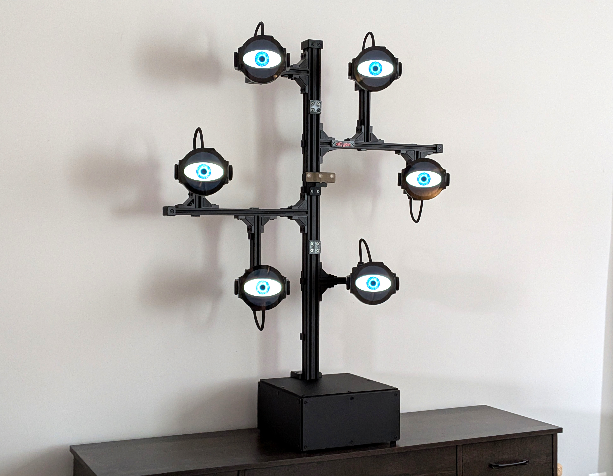
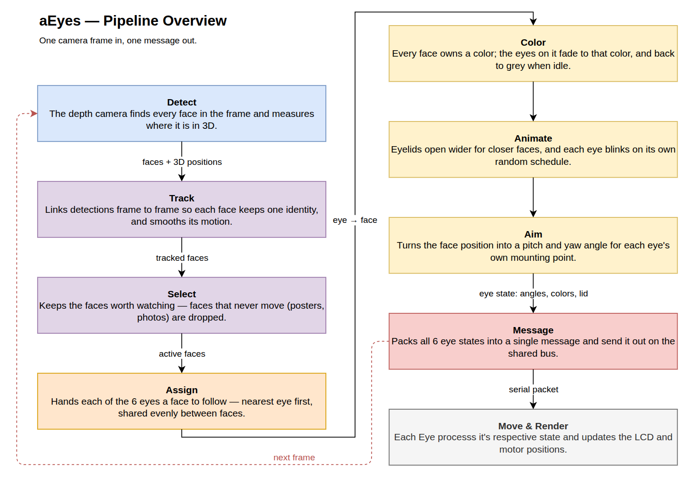
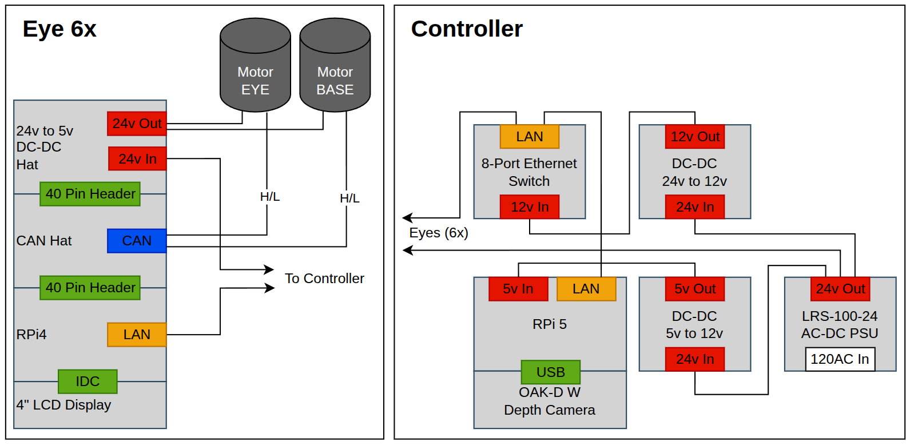
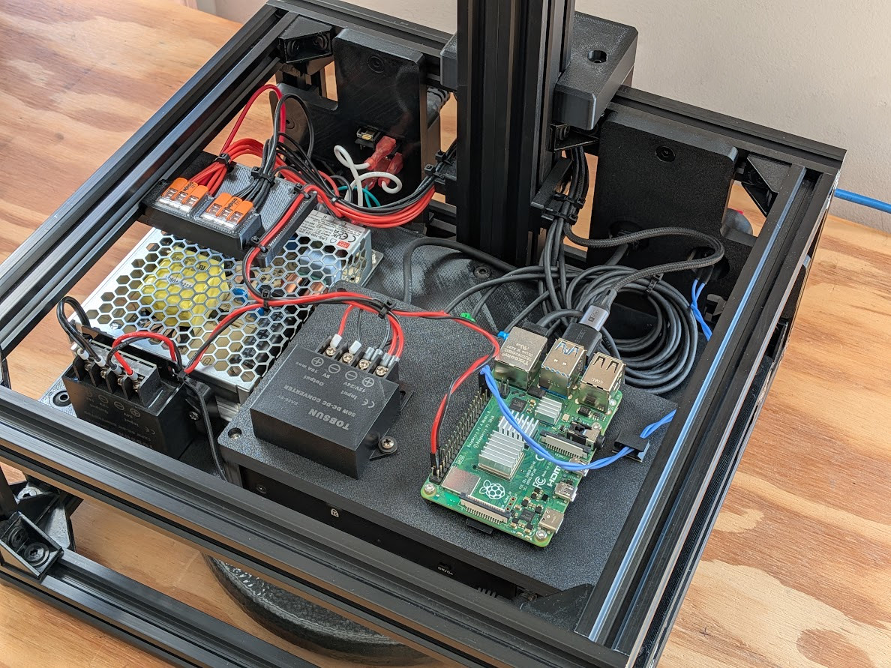
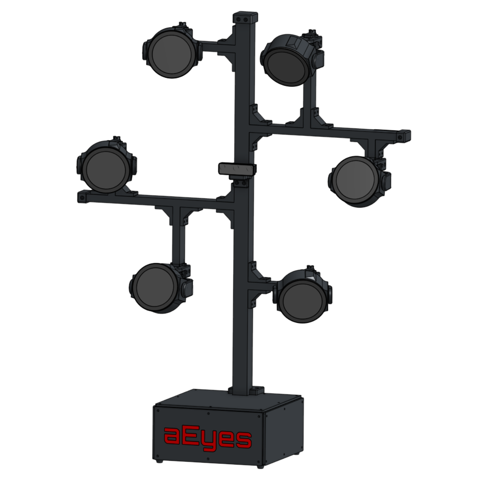
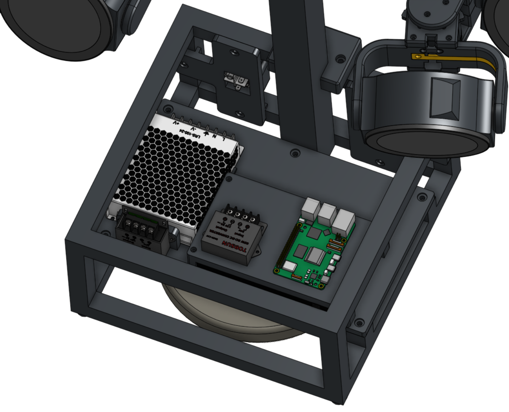

# aEyes

aEyes is a robotic art project adding physicality to the ubiquitous surveillance apparatus that we walk beneath daily.

<table>
  <tr>
    <td></td>
  </tr>
</table>

# Overview

The stereo depth camera, with onboard neural processing, detects faces and their relative positions, then feeds the data into a tracking and assignment pipeline that controls the positioning of the eyes. Eye assignments are distributed to the six nearest faces.

# UI

**TODO**

# Pipeline

The pipeline is fairly straight forward and the major parts are: **AI Camera Interface → Face Tracker → Eye Manager → Message Publisher → RPi/LCD/Motors**

<figure>
  
  <figcaption align="center">Pipeline Simplified.</figcaption>
</figure>

# System

The system is split into two subsystems: a **Controller** and **6 Eye units**, all connected over a wired Ethernet network.

# Hardware

**Controller**
- Raspberry Pi 4 (or 5)
- OAK-D W depth camera (USB)
- Mean Well LRS-100-24 AC/DC PSU (24V)
- DC-DC converter 24V → 12V
- DC-DC converter 24V → 5V
- 8-port Ethernet switch

**Eye units (×6)**
- Raspberry Pi 4B
- Waveshare 4" DSI LCD
- Waveshare RS485/CAN Hat
- DC-DC converter 24V → 5V
- 1× MG4010E-i10v3 CAN servo motor (yaw)
- 1× MG4005-v2 CAN servo motor (pitch)

# Installation / Setup / Execution

- [Controller](controller/README.md)
- [Eyes](eye/README.md)
- [Mechanical Notes](docs/MECHANICAL.md)
- [Misc Docs](docs/README.md)

# 3D CAD

aEyes was created in CAD using [OnShape](https://cad.onshape.com). The full assembly may be viewed/exported with this link: [aEyes CAD Assembly](https://cad.onshape.com/documents/3d927fbbde33024eb0f3feca/w/105fa9c43462d4971ca0f096/e/2fabb45a1dca49857035ca55)

<table>
  <tr>
    <td></td>
    <td></td>
  </tr>
</table>

# AI Disclosure

Project concept, aesthetic, engineering design, and original code base were conceived and executed by the author.

Portions of this codebase were reviewed, revised, and written with the assistance of various coding agents.
